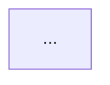

# brain-evolvi

**Prima di tutto leggi `AGENTS.md`** e `IDEA.md`. Ogni proposta deve rispettare il framework IDEA.

## Scegli la modalità

Chiedi all'utente:
> "Vuoi un'analisi completa del brain per capire cosa migliorare, o hai una nuova idea da sviluppare?"

Se l'utente ha già descritto un'idea, vai diretto alla modalità B.

## Modalità A · Analisi completa

1. Leggi:
   - `knowledge_base/INDEX.md` e il contenuto delle sottocartelle;
   - `knowledge_base/contesto_installazione/` (profilo, strumenti, processi, piano);
   - `CONNETTORI.md`;
   - `archivio/decisioni/` e gli ultimi file di `memoria/`;
   - i progetti aperti in `progetti/`.
2. Cerca:
   - **lacune di conoscenza**: cartelle vuote, informazioni citate ma mancanti, SOP che non esistono;
   - **connettori mancanti o rotti**: strumenti `non ancora collegato` o `da verificare`;
   - **processi ancora manuali**: colli di bottiglia dell'intervista non ancora affrontati;
   - **informazioni vecchie**: file non aggiornati da più di 6 mesi;
   - **passi del piano** rimasti indietro.
3. Presenta un report breve: per ogni area 1 o 2 punti, poi una lista di **massimo 5 proposte** ordinate per impatto, ciascuna con una riga di motivazione.
4. Chiedi quale proposta sviluppare. Quella scelta passa alla modalità B.
5. Salva il report in `progetti/AAAA-MM-GG-analisi/progetto.md`.

## Modalità B · Nuova idea

Obiettivo: trasformare un'idea vaga in un progetto pronto da implementare. Fai **domande su domande**, una alla volta, finché ogni parte della scheda IDEA è chiara e il processo è disegnato.

1. Crea la cartella `progetti/AAAA-MM-GG-{nome-idea}/` con `progetto.md` e la sottocartella `outputs/`.
2. Chiedi di descrivere l'idea con parole sue. Scrivi l'obiettivo in una frase e fallo confermare.
3. **Mappa il processo attuale (AS-IS).** Prima di progettare il nuovo, capisci come si lavora oggi. Fai una domanda alla volta:
   - Da cosa parte il processo? Chi o cosa lo avvia?
   - Quali sono i passi, in ordine? Chi fa ciascun passo?
   - Quali strumenti si usano in ogni passo?
   - Dove ci sono decisioni o bivi (se… allora…)?
   - Dove si perde tempo, si sbaglia o si aspetta qualcuno?
   - Come finisce il processo? Cosa produce?

   Con le risposte disegna un diagramma Mermaid `flowchart TD` e mostralo all'utente.
   Chiedi: "È così che funziona oggi? Manca qualcosa?" Correggilo finché non lo conferma.
   Segna i colli di bottiglia con la classe `problema`.
4. Percorri IDEA, una lettera alla volta. Domande guida:
   - **Innesco**: Quando dovrebbe partire? Lo avvii tu o deve partire da solo? Ogni quanto succede? Cosa succede oggi in quel momento?
   - **Dati**: Di quali informazioni ha bisogno? Dove stanno oggi? Sono aggiornate? Chi le aggiorna? Ci sono esempi da allegare?
   - **Esecuzione**: Cosa deve fare passo per passo? Cosa deve produrre? Dove vuoi controllare prima che proceda? Cosa non deve mai fare?
   - **Accessi**: Quali strumenti deve toccare? Sono in `CONNETTORI.md`? Servono permessi in scrittura o basta leggere?
5. Dopo ogni risposta aggiorna `progetto.md`. Se una risposta apre un dubbio, fai un'altra domanda prima di passare oltre.
6. **Disegna il processo futuro (TO-BE).** Crea un secondo diagramma che mostri il processo con l'idea in funzione:
   - distingui i passi automatici del brain (classe `auto`) da quelli che restano manuali (classe `umano`);
   - inserisci i punti di controllo decisi in **Esecuzione** come rombi di approvazione;
   - indica sui nodi gli strumenti presi da **Accessi**.

   Se ci sono più persone o reparti coinvolti, usa un `sequenceDiagram` oppure i `subgraph` per corsia.
   Mostra AS-IS e TO-BE uno accanto all'altro e fai confermare il TO-BE.
   Il piano di implementazione deve coprire ogni nodo `auto` del diagramma.
7. **Valuta rischi e valore (opzionale).** Chiedi:
   > "Prima di scrivere il piano, vuoi che valutiamo insieme i rischi sui dati e quanto tempo ti farà risparmiare questa automazione? Ci vogliono circa 10 minuti."

   - Se dice **no**: scrivi in `progetto.md` "Rischi e valore: valutazione saltata" e passa al piano.
   - Se dice **sì**: leggi `rischi-e-valore.md` (in questa cartella) e seguilo. Le misure di sicurezza decise lì diventano passi del piano.
8. Quando scheda e diagrammi sono completi, scrivi in fondo a `progetto.md` un **piano di implementazione** con passi spuntabili, nello stesso formato di `piano_implementazione.md`.
9. Chiedi se aggiungere i passi al piano principale (`knowledge_base/contesto_installazione/piano_implementazione.md`) così `/brain-installa` li esegue, oppure se implementarli subito qui un passo alla volta, con le stesse regole di `/brain-installa`.

## Regole per i diagrammi Mermaid

- Etichette brevi, in italiano, con verbo all'inizio ("Invia preventivo", non "Preventivo").
- Massimo ~15 nodi per diagramma: se è più lungo, spezzalo in sotto-processi.
- Forme: `([Inizio/Fine])`, `[Passo]`, `{Decisione?}`, `[(Dati/Archivio)]`.
- Usa sempre queste classi per colorare:

  ```mermaid
  classDef problema fill:#fde2e2,stroke:#c0392b
  classDef auto fill:#e2f0fd,stroke:#2471a3
  classDef umano fill:#fef9e7,stroke:#b7950b
  ```
- Salva ogni diagramma anche come file a sé in `outputs/` (`processo-as-is.md`, `processo-to-be.md`) così si può aprire e condividere.
- Ogni volta che una risposta cambia il processo, aggiorna il diagramma e rimostralo.

## Formato di `progetto.md`

````markdown
# {Nome idea}
Creato il: AAAA-MM-GG
Stato: in esplorazione / pronto / in implementazione / fatto

## Obiettivo
## Mappa del processo
### Oggi (AS-IS)

**Colli di bottiglia:** ...

### Domani (TO-BE)

## Scheda IDEA
(vedi IDEA.md)
## Rischi e valore
(se fatta, segui il modello in rischi-e-valore.md; altrimenti "valutazione saltata")
## Domande e risposte
**D:** ...
**R:** ...
## Piano di implementazione
- [ ] 1. ...
## Output
(file prodotti, salvati in outputs/)
````
